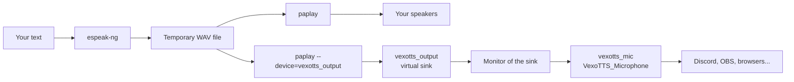

<div align="center">

# 🎤 VexoTTS

**Type it. Hear it. Send it to your calls and streams.**

A lightweight text-to-speech app for Linux that talks through your speakers *and* a virtual microphone, so any app that can record from a mic can hear it.


</div>

<!-- Add a screenshot: save it as docs/screenshot.png, then uncomment the line below.
<p align="center"></p>
-->

---

## Why VexoTTS?

Sometimes you can't or don't want to use your voice: a quiet room, a shared space, a voice you'd rather not share, or you just want to experiment. VexoTTS turns typed text into speech and routes it where you need it, with one window and no audio-routing headaches.

## Features

- **Virtual microphone.** Creates a "VexoTTS_Microphone" input that Discord, OBS, browsers, Audacity and other apps can select.
- **Hear it yourself.** Plays on your normal speakers at the same time, or turn either output off with a checkbox.
- **Lots of voices.** Every language eSpeak NG ships with, plus voice styles (male 1–7, female 1–5, croak, whisper).
- **Full control.** Speed, pitch and volume sliders, with a one-click reset.
- **Recent phrases.** A sidebar remembers what you said. Click a phrase to load it again.
- **Remembers your setup.** Text, voice, sliders, outputs and window size are saved between runs.
- **Instant stop.** Cut playback off at any time with the Stop button or `Esc`.
- **Tidy by design.** Only removes virtual devices that VexoTTS created itself, and only if you leave "Remove virtual mic on exit" ticked.
- **Safe text handling.** Text is passed to eSpeak NG over stdin, so long messages and text starting with `-` work fine.

## Quick start

### 1. Install the system packages

**Ubuntu / Debian**

```bash
sudo apt install git python3 python3-venv espeak-ng pulseaudio-utils
```

`pulseaudio-utils` provides the `pactl` and `paplay` commands. On PipeWire systems (the default on recent Ubuntu, Fedora and others) these talk to PipeWire's PulseAudio layer, so you don't need to switch audio servers.

**Fedora**

```bash
sudo dnf install git python3 espeak-ng pulseaudio-utils
```

**Arch**

```bash
sudo pacman -S git python espeak-ng libpulse
```

### 2. Get the code and install PySide6

```bash
git clone https://github.com/whoru677/VexoTTS.git
cd VexoTTS
python3 -m venv .venv
.venv/bin/pip install -r requirements.txt
```

A virtual environment is the safest route, because newer Ubuntu and Debian block plain `pip install` outside one.

### 3. Run it

```bash
.venv/bin/python main.py
```

> If the app starts but a required program is missing, it tells you which one.

## Using it

1. Type or paste some text.
2. Pick a language and voice, and adjust speed, pitch and volume.
3. Choose where the sound goes: **Play on my speakers**, **Send to virtual microphone**, or both.
4. Press **Speak** (or `Ctrl+Enter`). Press **Stop** (or `Esc`) to cut it off.

### Use it as a microphone

In the app you want to talk into (Discord, OBS, a browser call, a recorder), open its audio settings and choose **VexoTTS_Microphone** as the input device.

The header of the VexoTTS window shows whether the virtual mic is ready. If it says it's off, click it to set it up again.

> **Tip:** Apps usually only read their device list when they start, or when you open their audio settings. If "VexoTTS_Microphone" doesn't show up, start VexoTTS first, then reopen the other app's settings.

| Shortcut | Action |
| --- | --- |
| `Ctrl+Enter` | Speak |
| `Esc` | Stop |

## How it works

VexoTTS is a small PySide6 front end over standard Linux tools, so there is very little custom audio code to go wrong.



- `pactl load-module module-null-sink` creates the virtual output (`vexotts_output`).
- `pactl load-module module-remap-source` turns that output's monitor into a proper microphone (`vexotts_mic`). Many apps hide raw monitor devices, but they show a remapped source as a normal mic.
- The speech is generated once into a temporary WAV file, so your speakers and the virtual mic receive identical audio. The file is deleted afterwards.
- Subprocesses run through Qt's `QProcess`, so the interface never freezes and Stop works immediately.

## Troubleshooting

**"Missing required program(s)" on launch**
Install the system packages from step 1.

**The mic doesn't appear in my app**
Check that the devices exist:

```bash
pactl list short sinks   | grep vexotts
pactl list short sources | grep vexotts
```

If both lines show up, restart the other app or reopen its audio settings. If nothing shows up, click the red status text in the VexoTTS header and read the error it reports.

**I can hear it, but the other app can't (or the reverse)**
Make sure *Send to virtual microphone* is ticked, and that the app is set to the input named **VexoTTS_Microphone**, not your real microphone.

**The app says the virtual output could not be created**
Your audio server may not support the needed modules. VexoTTS works with PipeWire (via `pipewire-pulse`) and PulseAudio.

**Flatpak and Snap apps**
Flatpak apps normally see the system's audio devices, so the virtual mic should appear in them like in any other app. Sandboxed apps vary, so test with a recorder or Discord first.

**Roblox voice chat (for example through Sober)**
Whether this works depends on the game client's own microphone support, which I haven't verified. Test VexoTTS with another app first so you know the virtual mic itself works.

**The voice sounds robotic**
That's eSpeak NG. It's tiny, fast and works everywhere, but it isn't a neural voice.

## Where settings live

Settings and recent phrases are stored by Qt in `~/.config/VexoTTS/VexoTTS.conf`. Delete that file to reset everything.

## Roadmap

- [ ] Saved voice presets
- [ ] Global hotkey to speak while the window is in the background
- [ ] Load text from a file
- [ ] Support for neural voices (for example Piper)
- [ ] Packaging (Flatpak or AppImage)

Ideas and bug reports are welcome. Open an issue and say what you'd like to see.

## Contributing

1. Fork the repo and create a branch.
2. Make your change, and run the app to check it works.
3. Open a pull request and describe what changed and why.

## Credits

- [eSpeak NG](https://github.com/espeak-ng/espeak-ng) for speech synthesis.
- [PySide6 / Qt](https://doc.qt.io/qtforpython-6/) for the interface.
- PipeWire and PulseAudio for the audio plumbing.
